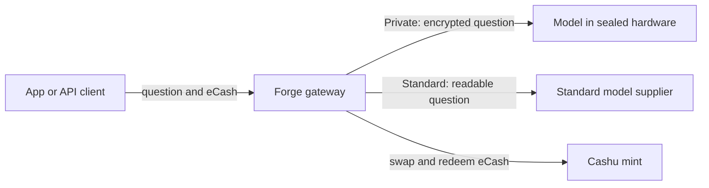

# Forge AI

Forge AI lets people ask AI models questions and pay for each answer with eCash, without an account. It has a phone app made for people who read with difficulty, and an OpenAI-compatible API for developers.

**eCash** is digital cash. A **mint** is a server that issues eCash tokens and redeems them, like a bank that prints notes. Whoever holds a token can spend it. The mint signs each token without seeing it, so it cannot link a token it issued to the moment it is spent. Forge uses Cashu eCash.

## Try it

- **The app:** https://ai.forge-reserve.com/v2/ works in the browser of any phone or computer. You hold one button and talk. The screens use icons and pictures more than words, and a Listen button reads them aloud.
- **The API guide:** https://ai.forge-reserve.com/docs/ (the source is [docs/API.md](docs/API.md)).
- **The module guide:** https://ai.forge-reserve.com/docs/modules/ (the source is [docs/modules/](docs/modules/README.md)).

The hosted gateway is invite only. An invite code opens a balance with nothing on it, and that balance can ask the free models at no cost. Ask for an invite on the waitlist at https://ai.forge-reserve.com/beta/. The free models are Standard models (see below), so the app asks you to turn off Private only before you use them.

## How it works



### Paying with eCash

There are two ways to pay:

- **Per request.** Send a request with no key. The gateway answers `402 Payment Required` with a payment request. Send the request again with an eCash token in the `X-Cashu` header. The gateway charges what the answer cost and returns the rest as eCash change.
- **A balance.** Put eCash on a balance and get a balance key (`sk-forge-...`). Use the key like any API key. Take what is left out as eCash at any time.

A balance can also be filled by a Lightning payment or with eCash from another mint. On-chain bitcoin is built and off by default. In the app you can also scan a paper note: a printed QR code that holds eCash. The Android and iPhone apps can take funds from a Cashu card over NFC (so far tested with a simulated card only).

There are no accounts. The gateway asks for no name, email or password. The balance key is the only way to spend a balance, and the gateway stores only a hash of it. If you lose the key, the balance is lost.

### Private and Standard models

- **Private models** run in sealed hardware. Sealed hardware is a server whose processor keeps the model's memory encrypted and can prove which code it runs (this proof is called attestation). The app checks that proof and encrypts the question to that machine, so the gateway passes on data it cannot read. Today these models run at Tinfoil.
- **Standard models** run at an ordinary supplier. The gateway and the supplier can read the question and the answer. Some Standard models are free at the moment.

The app has a setting called Private only. It is on by default, and while it is on the app uses Private models only.

### What the operator can and cannot see

The operator is whoever runs the gateway. [docs/PRIVACY.md](docs/PRIVACY.md) gives the full detail. In short:

- The gateway never logs or stores the text of questions and answers. Its logs keep the request id, model, token counts, cost, status and timing.
- With a Private model and encryption in the app, the gateway cannot read the question or the answer. It still sees the model name, the size of the request, the timing, the token counts and your network address.
- With a Standard model, the gateway reads the question and answer in memory while it passes them on. The supplier reads them too and may keep them.
- Voice is sent in plain form. When the engine turns your voice into words, the recording passes through the gateway, even for a Private model. An answer the engine reads aloud passes through it as text. Where the phone can hear the voice itself, the sound stays on the phone.
- Your network address reaches the gateway. Use Tor or a VPN to hide it.
- Every request made with the same balance key can be linked to the others.
- The claims about sealed hardware rest on the word of the chip makers (AMD, Intel and NVIDIA).
- The app keeps your conversations on the phone. Anyone who holds the phone unlocked can read them. The app can burn one conversation, delete them on a timer, or erase everything.

## Run it yourself

You need Node 22.18 or later (CI and the Docker image use Node 24), pnpm, and Docker for the local test mints.

```sh
git clone https://github.com/ForgeReserve/forge-ai.git
cd forge-ai
pnpm install --frozen-lockfile
pnpm mint:up
FORGE_TRUSTED_MINTS=http://127.0.0.1:3338 \
FORGE_MODELS_FILE=config/models.dev.json \
FORGE_DB_PATH=data/dev.db \
FORGE_INVITE_ONLY=false \
FORGE_FOREIGN_DISCOVERY_RELAYS= \
pnpm start
```

Open http://localhost:8787/v2/ for the app.

- `pnpm mint:up` starts four local Cashu mints in Docker, on ports 3338 to 3341. Their eCash is test money. They keep running, and every checkout on your computer shares them. `pnpm mint:down` stops them.
- `config/models.dev.json` adds mock models that answer without any API key. The mock models are Standard models, so turn off Private only in the app to ask them.
- `FORGE_INVITE_ONLY=false` opens balances without an invite code.
- `FORGE_FOREIGN_DISCOVERY_RELAYS=` stops the gateway from reading public Nostr relays to find other mints.

To put test money in the app, run `pnpm test-token 50 usd` in another terminal. It prints an eCash token worth 50 cents from the local mint. Paste it in Add money, eCash.

The natural voice (about 68 MB) is not in the repository. `node scripts/phonon-model.ts` fetches it. Without it the app works and offers the other voices.

To use real models, set `TOKENFACTORY_API_KEY` and `TINFOIL_API_KEY`: `config/models.dev.json` lists the real models beside the mock ones. To run a gateway in production with Docker Compose and HTTPS, and for every setting, read [docs/OPERATING.md](docs/OPERATING.md).

## Build on it

### The API

The API speaks OpenAI chat completions at `https://ai.forge-reserve.com/v1`. Send a balance key as the API key, or pay each request with an eCash token. Speech to text, text to speech and funding routes are there too. With a balance key in `FORGE_KEY`, this asks a free model (from [docs/API.md](docs/API.md)):

```bash
curl -s https://ai.forge-reserve.com/v1/chat/completions \
  -H "Authorization: Bearer $FORGE_KEY" \
  -H 'Content-Type: application/json' \
  -d '{"model": "glm-5.3-flash", "messages": [{"role": "user", "content": "Say hello in five words."}]}'
```

The API guide shows how to open a balance, add funds, encrypt a question to a Private model, and use the OpenAI SDKs for JavaScript and Python.

### Modules

The app is built from modules. A module is a folder with a manifest and a JavaScript file. Six kinds ship today: ways to pay (`fund`), voice in, voice out, photo filters for Share unseen (`filter`), looks (colours) and modes (the home and answer screens). The gateway has modules too: suppliers of models and ways to fund a balance.

Start with [docs/modules/first-module.md](docs/modules/first-module.md). It builds a look and a photo filter step by step. Modules are not signed or sandboxed yet, so a new module reaches people as a pull request that adds it to the app ([docs/modules/README.md](docs/modules/README.md)).

### The phone apps

The Android and iPhone apps carry the same web app inside a Capacitor shell, with a few native parts (card taps, speech on the phone, sharing). The Android app is in `android/` ([docs/ANDROID.md](docs/ANDROID.md)). The iPhone app is in `ios/` and has been run in the iOS Simulator only ([docs/IOS.md](docs/IOS.md)). Both talk to `https://ai.forge-reserve.com` until you set another server in the app. [docs/APP.md](docs/APP.md) describes every part of the app.

### Bellows

[Bellows](https://github.com/ForgeReserve/bellows) ([site](https://bellows.forgereserve.org)) is a separate public project: an AI gateway that runs inside sealed hardware, so its operator cannot read questions. Its site says what stays sealed and where the limits are. The Forge app's engine client already answers its proof-of-work challenge.

## Contribute

The project meets developers at a hackathon from 2 to 4 December 2026. Help is welcome on these:

- **Guides.** An organisation publishes a signed package of its own guidance, and members ask it by voice, offline, on the phone. [docs/GUIDES.md](docs/GUIDES.md) explains the design and lists five pieces to build at the event, each one or two days of work.
- **Cover games.** Playful mode opens on a small game that hides the app. A new game is a folder with its own rules. [docs/PLAYFUL.md](docs/PLAYFUL.md) (Add a cover game) gives the interface.
- **Modules.** A new look, photo filter or way to pay ([docs/modules/](docs/modules/README.md)).
- **The rest of the plan.** [docs/ROADMAP.md](docs/ROADMAP.md) lists what is still to build, such as languages, the witness tool, protection steps, the passphrase lock, and signed modules in a sandbox.

### Run the checks

```sh
pnpm -s typecheck
pnpm -s test                     # unit tests
pnpm mint:up && pnpm test:e2e    # end to end, against the local mints
pnpm test:ui                     # the app in Chrome at phone size; needs the local mints
```

Before you push a change that a phone shows, run `pnpm test:ui:linux`: it runs the UI tests in Linux as CI does. If you change `docs/API.md` or `docs/modules/`, run `pnpm build:docs` and commit the pages it writes under `public/docs/`. CI runs on every pull request, and the one check that must pass is `ci-ok`. [docs/CI.md](docs/CI.md) explains the jobs and what each test suite covers.

### Security

Report a security problem by email to **security@forge-reserve.com**. Do not open a public issue for it. [SECURITY.md](SECURITY.md) says what to include and how to test safely.

### Licence

Forge AI is released under the MIT licence: see [LICENSE](LICENSE). Libraries copied into `public/vendor/` keep their own licences, listed in `public/vendor/licenses/`.

## The repository

| Path | What is in it |
| - | - |
| `src/` | The gateway: one Node server (Hono, with SQLite through `node:sqlite`). `src/suppliers/` holds the model suppliers |
| `public/v2/` | The Forge app. Its modules are in `public/v2/modules/` |
| `public/` | The Classic chat page at `/`, the admin page (`public/admin/`), and the built docs (`public/docs/`) |
| `android/`, `ios/` | The Android and iPhone apps (Capacitor) |
| `config/` | The model catalogs: `models.json` and `models.dev.json` (with mock models) |
| `docs/` | Design and reference pages. `docs/modules/` is the module guide |
| `test/` | `unit/`, `e2e/` (local mints), `ui/` (Chrome), `live/` (a real supplier, needs a key), `support/` (fakes: mint, card, till) |
| `scripts/` | Build, vendor, test and printing scripts |
| `examples/` | A program that pays for a request end to end (`pnpm demo:agent`) |
| `deploy/` | Deployment files for the credit mint and the project website |
