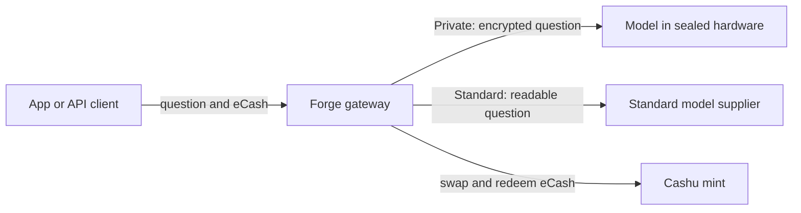

# How Forge works

**eCash** is digital cash. A **mint** is a server that issues eCash tokens and redeems them, like a bank that prints notes. Whoever holds a token can spend it. The mint signs each token without seeing it, so it cannot link a token it issued to the moment it is spent. Forge uses Cashu eCash.

## Paying with eCash

There are two ways to pay:

- **Per request.** Send a request with no key. The gateway answers `402 Payment Required` with a payment request. Send the request again with an eCash token in the `X-Cashu` header. The gateway charges what the answer cost and returns the rest as eCash change.
- **A balance.** Put eCash on a balance and get a balance key (`sk-forge-...`). Use the key like any API key. Take what is left out as eCash at any time.

A balance can also be filled by a Lightning payment or with eCash from another mint. On-chain bitcoin is built and off by default. In the app you can also scan a paper note: a printed QR code that holds eCash. The Android and iPhone apps can take funds from a Cashu card over NFC (so far tested with a simulated card only).

There are no accounts. The gateway asks for no name, email or password. The balance key is the only way to spend a balance, and the gateway stores only a hash of it. If you lose the key, the balance is lost.

## Private and Standard models

- **Private models** run in sealed hardware. Sealed hardware is a server whose processor keeps the model's memory encrypted and can prove which code it runs (this proof is called attestation). The app checks that proof and encrypts the question to that machine, so the gateway passes on data it cannot read. Today these models run at Tinfoil.
- **Standard models** run at an ordinary supplier. The gateway and the supplier can read the question and the answer.

The app has a setting called Private only. It is on by default, and while it is on the app uses Private models only.

## What the operator can and cannot see

The operator is whoever runs the gateway. [PRIVACY.md](PRIVACY.md) gives the full detail. In short:

- The gateway never logs or stores the text of questions and answers. Its logs keep the request id, model, token counts, cost, status and timing.
- With a Private model and encryption in the app, the gateway cannot read the question or the answer. It still sees the model name, the size of the request, the timing, the token counts and your network address.
- With a Standard model, the gateway reads the question and answer in memory while it passes them on. The supplier reads them too and may keep them.
- Voice is sent in plain form. When the engine turns your voice into words, the recording passes through the gateway, even for a Private model. An answer the engine reads aloud passes through it as text. Where the phone can hear the voice itself, the sound stays on the phone.
- Your network address reaches the gateway. Use Tor or a VPN to hide it.
- Every request made with the same balance key can be linked to the others.
- The claims about sealed hardware rest on the word of the chip makers (AMD, Intel and NVIDIA).
- The app keeps your conversations on the phone. Anyone who holds the phone unlocked can read them. The app can burn one conversation, delete them on a timer, or erase everything.
